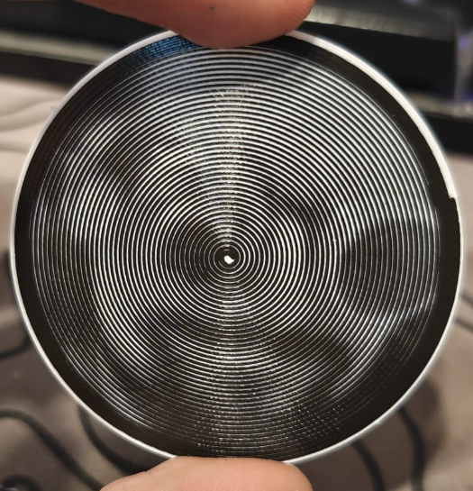
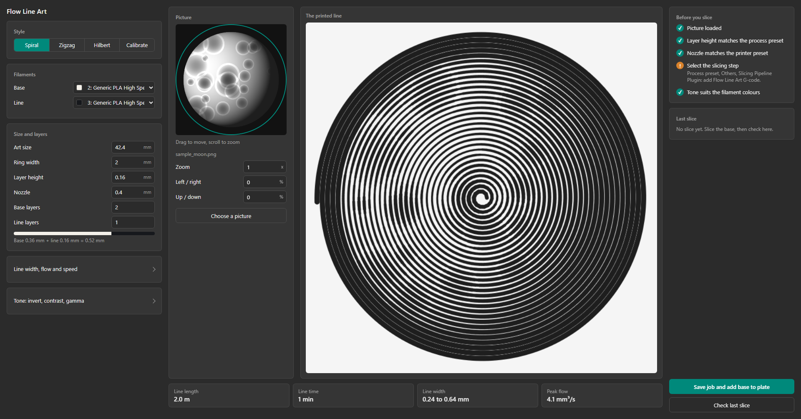
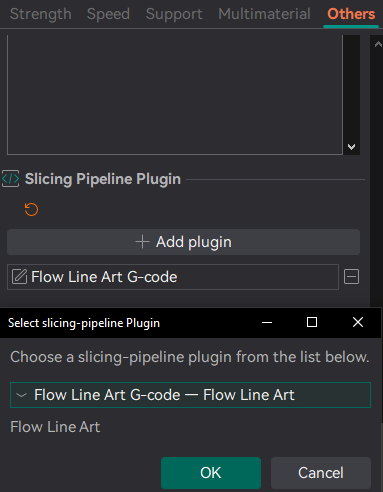
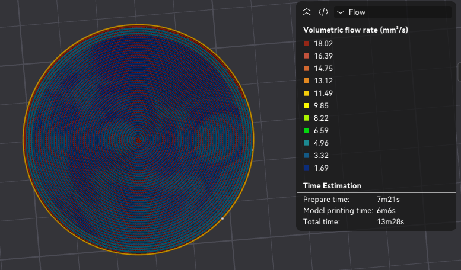
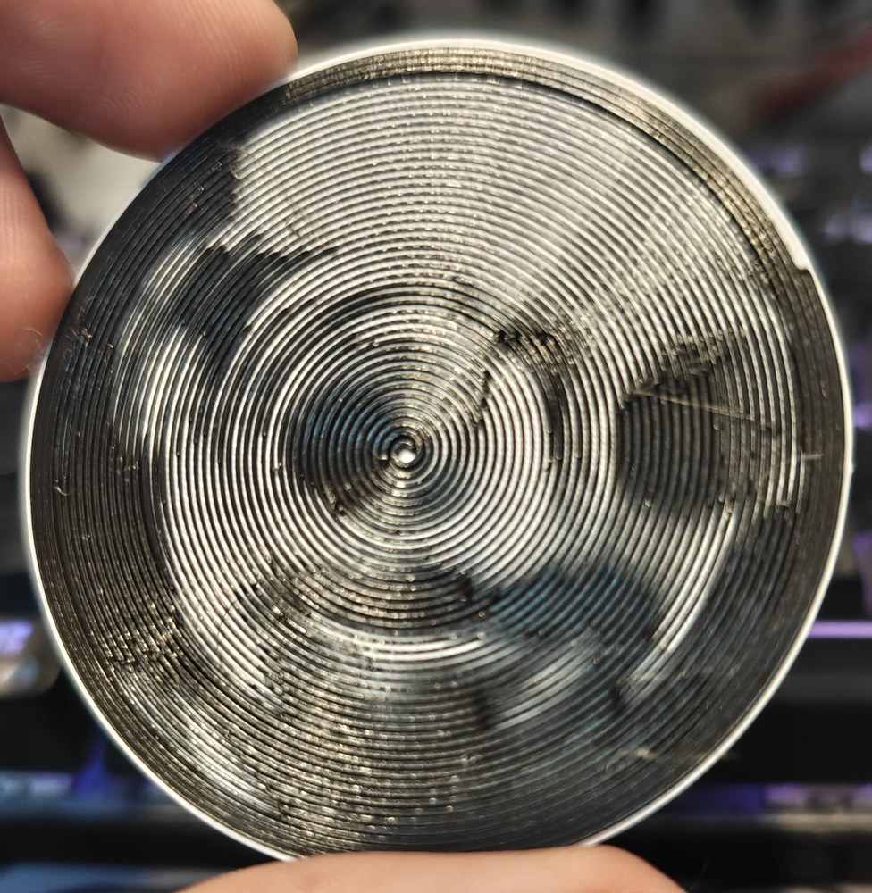

# Flow Line Art

Also on [Orca Cloud](https://cloud.orcaslicer.com/app/plugins/shared-plugins/363402d5-9018-4242-919f-a4341146d616).

Upload any photo and get a disc printed as a single unbroken spiral. The picture appears because the line swells and thins, with no color changes inside the picture.

**How to use**
1. Open the Flow Line Art tab and pick an image. Drag it to position it, scroll to zoom.
2. Choose the art size, the base and art filaments, the layer height and the number of base and art layers.
3. Press Save job and add base to plate. The base lands on the plate, with each filament already assigned.
4. In the process preset, under Others, set Slicing Pipeline Plugin to Flow Line Art G-code.
5. Slice. On a Bambu Lab printer the preview shows the line.

**The Slicing Pipeline Plugin setting**
The picture is made when you slice. Flow Line Art adds a slicing step that finds the top layers of its base and replaces them with the line. OrcaSlicer runs that step only when it is selected: in the process preset, open Others, find Slicing Pipeline Plugin, press Add plugin and choose Flow Line Art G-code. Save the preset to keep it. A print that is not the Flow Line Art base is left as it is, so the setting can stay on.

**What it does**
- Draws the picture as one continuous line, with no travel moves inside the art.
- Changes only the filament flow along the line, at a constant speed, within your filament's volumetric limit.
- Spiral on a disc, zigzag lines, or a Hilbert curve on a square base.
- Separate filaments for the base and the art, or one filament with a pause to swap it.
- One or more art layers, which retrace the same line.
- Calibration pattern, to match tones to your filaments.
- Flow multiplier, contrast, gamma and invert.

**Notes**
- Tested with real prints on a Bambu Lab X1 Carbon. Klipper G-code was tested on sliced files only, not printed.
- On printers other than Bambu Lab the slicer preview shows the plain base. The line is in the exported file.
- Adding the base to the plate automatically is Windows only. Elsewhere, the page shows the file to import.
- The layer height and nozzle you enter must match your presets, or the slice stops with a message.
- Free and open source, GPL-3.0-or-later.

Has a picture that did not come out well? Leave a comment with a photo of the print and your settings.

## The tab

## The setting

## The sliced line

## Install
Download the `.whl` file from the [latest release](../../releases/latest) and install it from the Plugins menu in OrcaSlicer, or subscribe on Orca Cloud.

Requires OrcaSlicer 2.5.0 or later. License: GPL-3.0-or-later.

Relief is experimental: it has had one test print, and the raised areas are rougher than the flat modes.
